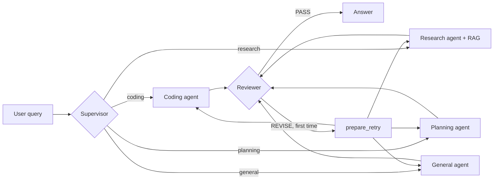

# agentic-chatbot

A local, multi-agent chatbot built with **LangGraph** and **Ollama**. A
supervisor routes each query to a specialist agent, a reviewer checks the
draft (with one retry), and a RAG pipeline over your own PDFs/text files
grounds the research agent. Everything runs locally; **LangSmith** tracing is
optional.

## How it works



- **Supervisor** (`app/agents/supervisor.py`): classifies the query with a
  small LLM (`ROUTER_MODEL`). If the model is disabled, unreachable, or
  returns an unknown label, it falls back to word-boundary keyword routing.
  The chosen route and method (`llm` / `keyword`) are returned in state.
- **Agents** (`app/agents/`): coding, research, planning, general. The
  research agent retrieves the top chunks from Chroma and answers with
  `[Source N]` citations.
- **Reviewer**: returns `PASS` or `REVISE: <feedback>`. On `REVISE`, the query
  is re-sent to the same agent once with the feedback (`MAX_RETRIES`).
- **Memory**: LangGraph `MemorySaver` checkpointer per `thread_id`; the CLI and
  Streamlit app also pass recent chat history to the agents.
- **Metrics**: every Ollama call records tokens, latency, time to first token,
  and a reference cost estimate (`app/agents/ollama_metrics.py`).

## Project layout

```
app/
  agents/       supervisor, coding, research, planning, general, reviewer, ollama_metrics
  graph/        workflow (StateGraph), routing, state
  rag/          ingestion, vector_store (Chroma + MiniLM embeddings), retriever
  prompts/      one prompt module per agent
  evaluation/   dataset, metrics, run_evaluation
  memory/       checkpointer
  config.py     all settings, overridable via env / .env
  main.py       CLI chat
streamlit_app.py  chat UI
tests/            pytest suite
data/documents/   files to ingest for RAG
```

`app/api/`, `app/tools/` and `app/memory/conversation.py` are placeholders
for future work (FastAPI endpoints, calculator / Python tools).

## Setup

1. Install dependencies:

   ```bash
   python3 -m pip install -r requirements.txt
   ```

2. Run Ollama and pull the models (defaults shown):

   ```bash
   ollama pull qwen3.5:4b       # router
   ollama pull qwen3.5:latest   # agents + reviewer
   ```

3. Add `.pdf` or `.txt` files to `data/documents/` and build the vector store
   (re-run whenever you add documents):

   ```bash
   python3 -m app.rag.ingestion
   ```

4. Start a chat interface:

   ```bash
   python3 -m streamlit run streamlit_app.py   # web UI, shows which agent replied
   python3 -m app.main                         # terminal chat ("new", "exit")
   ```

## Configuration

Set via environment variables or a local `.env` (see `app/config.py`).

| Variable | Default | Purpose |
|---|---|---|
| `OLLAMA_BASE_URL` | `http://localhost:11434` | Ollama server |
| `ROUTER_MODEL` | `qwen3.5:4b` | Model used by the supervisor |
| `AGENT_MODEL` | `qwen3.5:latest` | Model used by agents and reviewer |
| `USE_LLM_ROUTER` | `true` | `false` = keyword routing only |
| `ROUTER_TIMEOUT` | `30` | Seconds before falling back to keywords |
| `MAX_RETRIES` | `1` | Reviewer-triggered retries |
| `LANGSMITH_TRACING` | `true` | Needs `LANGSMITH_API_KEY` |

## Evaluation

```bash
python3 -m app.evaluation.run_evaluation
```

Runs 10 labelled queries (coding, research, planning, general, RAG) and
writes `evaluation_results.json` with routing correctness, keyword coverage,
latency, reviewer decision, and retries.

Last recorded run, **with the earlier keyword-only supervisor**:

| Metric | Result |
|---|---|
| Routing accuracy | 8 / 10 |
| Reviewer PASS on first review | 8 / 10 (2 retried after `REVISE`) |
| Avg expected-keyword coverage | 96.7% |
| Avg latency per query | 27.7 s |

The two routing misses were "Explain RAG architecture in simple words"
(sent to general) and "difference between classification and regression"
(sent to coding, because `class` matched inside "classification"). The
LLM router and word-boundary fallback target exactly these cases; re-run the
evaluation to get updated numbers.

## Tests

```bash
python3 -m pytest tests -q
```

The suite runs offline: the supervisor tests mock the router model.
